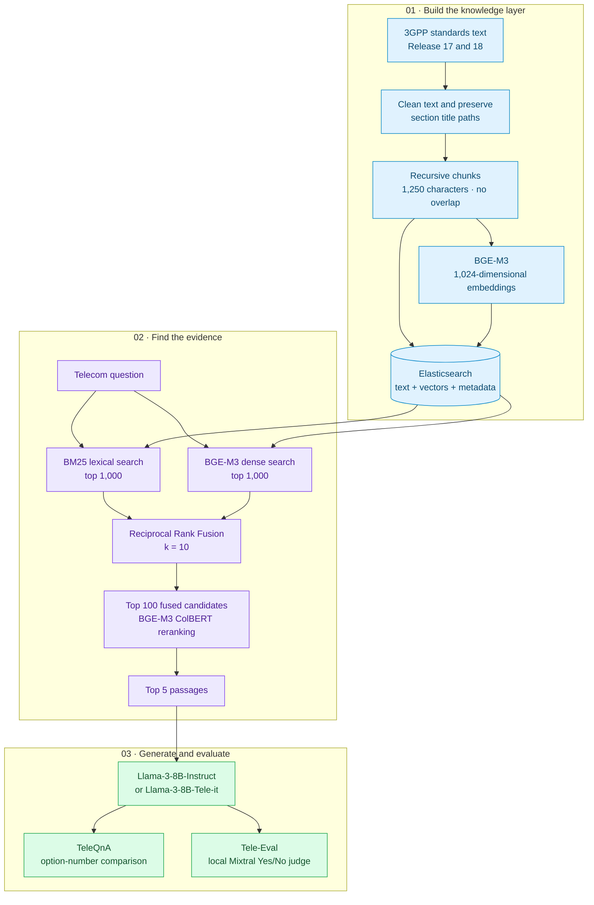

# Chat3GPP

**Maneswar Sahu | Wisdom Lab, IIT Kanpur | January–May 2026**

**Supervisor:** Dr. Rohit Budhiraja · **Mentor:** Mr. Chethan R.

Retrieval-augmented question answering over 3GPP Release 17/18 standards using Elasticsearch, BGE-M3, Llama-3-8B-Instruct, and Llama-3-8B-Tele-it. The internship covered corpus preprocessing, hybrid retrieval, RRF, reranking, and evaluation on TeleQnA and Tele-Eval. It also added a Tele-it + RAG comparison and explored graph-guided Chat3GPP-2.0.

## Architecture

## Results

From the [internship report](docs/Internship_Report_IITK.pdf):

| Benchmark | Configuration | Correct / accepted | Reported score |
|---|---|---:|---:|
| TeleQnA MCQ | **Llama-3-8B-Instruct + frozen final RAG** | 1,180 / 1,514 | **77.939%** |
| TeleQnA MCQ | Tele-it + frozen final RAG | 1,069 / 1,514 | 70.608% |
| TeleQnA MCQ | Tele-it without RAG | 790 / 1,514 | 52.180% |
| TeleQnA MCQ | Tele-it without RAG, paper-faithful prompt | 777 / 1,514 | 51.321% |
| Tele-Eval open-ended | Llama-3-8B-Instruct + RAG | 42,643 / 58,627 | 72.736% |
| Tele-Eval open-ended | **Tele-it + RAG** | 51,292 / 58,627 | **87.489%** |
| Tele-Eval open-ended | Tele-it without RAG | 14,817 / 58,627 | 25.273% |

## Data

| Artifact | Count |
|---|---:|
| Cleaned Release 17/18 standards files | 1,843 |
| Final index chunks | 254,570 |
| TeleQnA questions | 1,514 |
| Tele-Eval questions | 58,627 |

## Documentation

- [Architecture and flowcharts](docs/ARCHITECTURE.md)
- [Experiment results](docs/EXPERIMENTS.md)
- [Execution workflow](docs/REPRODUCING.md)
- [Project files](docs/PROJECT_MAP.md)
- [Internship report](docs/Internship_Report_IITK.pdf)
