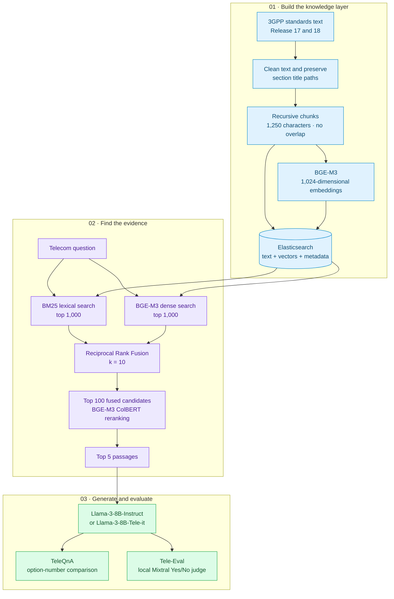

# Chat3GPP · Telecom Standards Question Answering

**Internship research by Maneswar Sahu · Wisdom Lab, IIT Kanpur · January–May 2026**  
**Supervisor:** Dr. Rohit Budhiraja · **Mentor:** Mr. Chethan R.

An implementation and experimental baseline for answering questions about **3GPP Release 17 and Release 18** using retrieval-augmented generation (RAG). It combines cleaned standards text, Elasticsearch, BGE-M3 hybrid retrieval, rank fusion, token-level reranking, and local Llama-3 or Tele-it generation.

The research asks a practical question: **how much does access to the right standards passages help a general or telecom-adapted language model?** This repository preserves the corpus, evaluation datasets, scripts, and experiment notes supplied with the internship work.

> **Snapshot scope:** this folder contains the cleaned `final` corpus but mostly `final_v2` indexing and evaluation scripts. The internship report describes a wider collection of experiments, completed outputs, and Chat3GPP-2.0. Those additional artifacts are not all present here. Reported results below are historical report findings, not scores recomputed from this checkout.

## Explore the project

| Read | What it explains |
|---|---|
| [Architecture](docs/ARCHITECTURE.md) | Ingestion, hybrid retrieval, RRF, reranking, and answer generation |
| [Reproduction guide](docs/REPRODUCING.md) | Environment, paths, index preparation, evaluation commands, and troubleshooting |
| [Experiments and evidence](docs/EXPERIMENTS.md) | Reported results, corpus versions, scoring, and limits on interpretation |
| [Project map](docs/PROJECT_MAP.md) | Which scripts to use and which are historical variants |
| [Internship report](docs/Internship_Report_IITK.pdf) | Full technical report supplied by the author |

## High-level design



The dense branch in this checkout uses **scripted cosine similarity over all indexed chunks**. Although the vector field is indexed, the search implementation does not issue an HNSW kNN query. See the [architecture notes](docs/ARCHITECTURE.md) for the exact behavior.

## Internship work

The report describes reproducing and extending the Chat3GPP methodology through corpus cleaning, Release 17/18 restriction, hybrid retrieval, model comparisons, and local benchmark evaluation. A central extension was connecting **Tele-it to the same RAG pipeline**, allowing comparison with Tele-it without retrieval.

The study also explored a graph-guided Chat3GPP-2.0 design. Its Neo4j, Pathway, frontend, and API services belong to a separate application; this checkout implements the batch research baseline.

## Reported findings

All numbers in this section come from the supplied report, sections 18–20. Completed prediction and judge JSON files are absent from this snapshot.

| Benchmark | Configuration | Correct / accepted | Reported score |
|---|---|---:|---:|
| TeleQnA MCQ | **Llama-3-8B-Instruct + frozen final RAG** | 1,180 / 1,514 | **77.939%** |
| TeleQnA MCQ | Tele-it + frozen final RAG | 1,069 / 1,514 | 70.608% |
| TeleQnA MCQ | Tele-it without RAG | 790 / 1,514 | 52.180% |
| TeleQnA MCQ | Tele-it without RAG, paper-faithful prompt | 777 / 1,514 | 51.321% |
| Tele-Eval open-ended | Llama-3-8B-Instruct + RAG | 42,643 / 58,627 | 72.736% |
| Tele-Eval open-ended | **Tele-it + RAG** | 51,292 / 58,627 | **87.489%** |
| Tele-Eval open-ended | Tele-it without RAG | 14,817 / 58,627 | 25.273% |

The best reported generator depends on the task: Llama-3-Instruct leads on MCQs, while Tele-it with retrieval leads on open-ended answers under the local Q4 Mixtral judge. The latter score measures judge acceptance; it is not directly interchangeable with MCQ accuracy or a differently configured evaluator.

The report lists `final_v2` at **77.411%**, below the frozen `final` result. A newer filename therefore does not imply a stronger experiment. The [experiment notes](docs/EXPERIMENTS.md) explain this distinction.

## What is included

| Artifact | Observed in this folder |
|---|---:|
| Cleaned standards files in `knowledge_base_cleaned_rel1718_final/` | 1,843 |
| TeleQnA questions in `data/teleqna/teleqna_paper.json` | 1,514 |
| Exact Tele-Eval questions in `data/teleeval_58627_exact.json` | 58,627 |
| Release 17 Tele-Eval questions | 26,225 |
| Release 18 Tele-Eval questions | 32,402 |

Alternative Tele-Eval candidate files are preserved for historical context. Model weights, a running Elasticsearch instance, its index snapshot, and completed experiment outputs are not bundled.

```text
.
├── configs/                              # Model locations, devices, chunk settings
├── data/                                 # TeleQnA and Tele-Eval JSON datasets
├── docs/                                 # Architecture, guide, results, report
├── knowledge_base_cleaned_rel1718_final/   # Supplied cleaned standards corpus
├── retrievers/                           # Elasticsearch retrieval and fusion
├── server/                               # Model loading and generation helpers
├── run_*.py                              # Batch experiments and judging
├── *index*.py                            # Index creation and resume helpers
├── build_clean_corpus.py                 # Historical raw-text cleaning
├── normalize_rel1718_final_v2.py          # Experimental normalization
├── release_map.json                      # Release metadata
└── requirements.txt                      # Historical dependency pins
```

## Getting started

Use a Linux machine with an NVIDIA GPU, local model checkpoints, and Elasticsearch. This is a research snapshot requiring path and dependency preparation before execution.

1. Follow the [environment and model setup](docs/REPRODUCING.md#1-prepare-the-environment).
2. Choose whether to index the supplied frozen corpus or reconstruct the separate v2 experiment. Keep corpus, index, and output names aligned.
3. Build and inspect the index before launching a full evaluation.
4. Run MCQ generation or open-ended generation followed by judging.

After completing the setup and index alignment in the guide, the principal entry points are:

```bash
python resume_clean_index_rel1718_final_v2_exact.py
python run_teleqna_eval_clean_rel1718_final_v2.py
python run_tele_it_teleqna_clean_rel1718_final_v2.py
python run_teleeval_eval_clean_rel1718_final_v2.py
python run_tele_it_teleeval_clean_rel1718_final_v2.py
```

These commands use the v2 index by default; they do not recreate the reported frozen-final scores without the documented changes and original environment.

## Limitations and next steps

Tables, figures, and message-flow diagrams are not represented by this text-only baseline. Zero-overlap chunks may separate related evidence. Retrieval uses neither an explicit release filter nor an approximate kNN query, and generated outputs do not expose clause citations. Some scripts suppress failures, making completeness checks essential.

Future work described in the report includes clause citations, release-aware search, retrieval-recall measurement, controlled retrieval ablations, multimodal standards parsing, and graph-guided document selection. The [architecture guide](docs/ARCHITECTURE.md#report-described-extension-chat3gpp-20) separates that proposed direction from the implementation present here.

## Credits and provenance

**Author:** Maneswar Sahu · [GitHub](https://github.com/ManeswarSahu11)  
**Internship:** Wisdom Lab, IIT Kanpur · January–May 2026  
**Supervisor:** Dr. Rohit Budhiraja · **Mentor:** Mr. Chethan R.

The supplied internship report is the source for the research narrative and historical results. Source files and dataset counts were reviewed to describe this particular snapshot. Original Chat3GPP methodology, TeleQnA, Tele-LLMs, BGE-M3, Elasticsearch, Transformers, and Mixtral are credited in the report bibliography.

No project license was supplied in the original folder. Model checkpoints, datasets, and standards content retain their respective upstream terms; this documentation does not assign them a new license.
