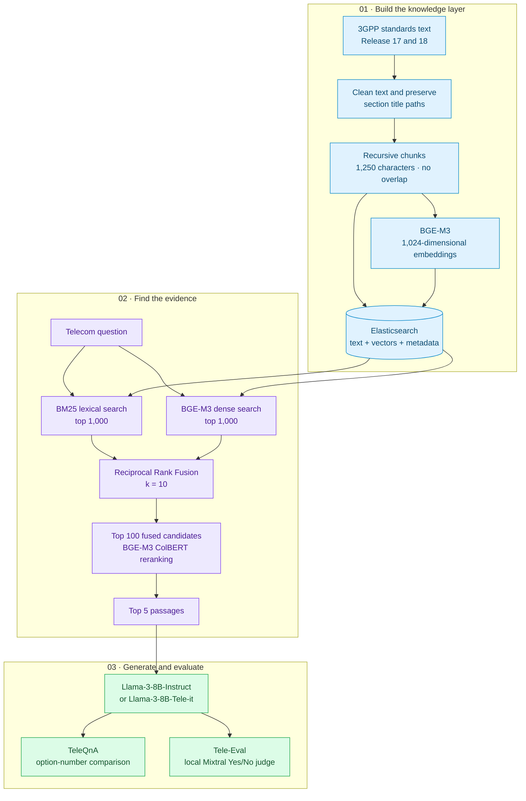

# Chat3GPP · Telecom Standards Question Answering

**Internship research by Maneswar Sahu · Wisdom Lab, IIT Kanpur · January–May 2026**  
**Supervisor:** Dr. Rohit Budhiraja · **Mentor:** Mr. Chethan R.

An implementation and experimental baseline for answering questions about **3GPP Release 17 and Release 18** using retrieval-augmented generation (RAG). It combines cleaned standards text, Elasticsearch, BGE-M3 hybrid retrieval, rank fusion, token-level reranking, and local Llama-3 or Tele-it generation.

The research asks a practical question: **how much does access to the right standards passages help a general or telecom-adapted language model?** This repository preserves the corpus, evaluation datasets, scripts, and experiment notes supplied with the internship work.


## Explore the project

| Read | What it explains |
|---|---|
| [Architecture](docs/ARCHITECTURE.md) | Ingestion, hybrid retrieval, RRF, reranking, and answer generation |
| [Reproduction guide](docs/REPRODUCING.md) | Environment, model configuration, and evaluation workflow |
| [Experiments and results](docs/EXPERIMENTS.md) | Results, corpus versions, and model comparisons |
| [Project map](docs/PROJECT_MAP.md) | Project components and script responsibilities |
| [Internship report](docs/Internship_Report_IITK.pdf) | Full technical report supplied by the author |

## High-level design



## Internship work

The report describes reproducing and extending the Chat3GPP methodology through corpus cleaning, Release 17/18 restriction, hybrid retrieval, model comparisons, and local benchmark evaluation. A central extension was connecting **Tele-it to the same RAG pipeline**, allowing comparison with Tele-it without retrieval.

The study also explored a graph-guided Chat3GPP-2.0 design. It combines Neo4j graph-guided document selection, Pathway streaming ingestion, hybrid retrieval, reranking, and answer generation.

## Reported findings

Results from the internship report, sections 18–20:

| Benchmark | Configuration | Correct / accepted | Reported score |
|---|---|---:|---:|
| TeleQnA MCQ | **Llama-3-8B-Instruct + frozen final RAG** | 1,180 / 1,514 | **77.939%** |
| TeleQnA MCQ | Tele-it + frozen final RAG | 1,069 / 1,514 | 70.608% |
| TeleQnA MCQ | Tele-it without RAG | 790 / 1,514 | 52.180% |
| TeleQnA MCQ | Tele-it without RAG, paper-faithful prompt | 777 / 1,514 | 51.321% |
| Tele-Eval open-ended | Llama-3-8B-Instruct + RAG | 42,643 / 58,627 | 72.736% |
| Tele-Eval open-ended | **Tele-it + RAG** | 51,292 / 58,627 | **87.489%** |
| Tele-Eval open-ended | Tele-it without RAG | 14,817 / 58,627 | 25.273% |

The best reported generator depends on the task: Llama-3-Instruct leads on MCQs, while Tele-it with retrieval leads on open-ended answers under the local Q4 Mixtral judge.

The selected frozen `final` configuration achieved **77.939%**, compared with **77.411%** for `final_v2`. See the [experiment results](docs/EXPERIMENTS.md).

## What is included

| Artifact | Count |
|---|---:|
| Cleaned standards files in `knowledge_base_cleaned_rel1718_final/` | 1,843 |
| TeleQnA questions in `data/teleqna/teleqna_paper.json` | 1,514 |
| Exact Tele-Eval questions in `data/teleeval_58627_exact.json` | 58,627 |
| Release 17 Tele-Eval questions | 26,225 |
| Release 18 Tele-Eval questions | 32,402 |

```text
.
├── configs/                              # Model locations, devices, chunk settings
├── data/                                 # TeleQnA and Tele-Eval JSON datasets
├── docs/                                 # Architecture, guide, results, report
├── knowledge_base_cleaned_rel1718_final/   # Supplied cleaned standards corpus
├── retrievers/                           # Elasticsearch retrieval and fusion
├── server/                               # Model loading and generation helpers
├── run_*.py                              # Batch experiments and judging
├── *index*.py                            # Index creation and resume helpers
├── build_clean_corpus.py                 # Historical raw-text cleaning
├── normalize_rel1718_final_v2.py          # Experimental normalization
├── release_map.json                      # Release metadata
└── requirements.txt                      # Historical dependency pins
```

## Execution workflow

The report describes the following workflow on the GPU server:

1. Activate the Python environment and configure local model paths.
2. Start Elasticsearch and build the Release 17/18 index.
3. Run TeleQnA evaluation with Llama-3-Instruct and Tele-it.
4. Generate Tele-Eval answers with and without retrieval.
5. Evaluate open-ended answers using the local quantized Mixtral judge.

See the [execution guide](docs/REPRODUCING.md) for the report's environment setup and evaluation stages.

## Credits

**Author:** Maneswar Sahu · [GitHub](https://github.com/ManeswarSahu11)  
**Internship:** Wisdom Lab, IIT Kanpur · January–May 2026  
**Supervisor:** Dr. Rohit Budhiraja · **Mentor:** Mr. Chethan R.

Based on the [internship technical report](docs/Internship_Report_IITK.pdf). Original Chat3GPP methodology, TeleQnA, Tele-LLMs, BGE-M3, Elasticsearch, Transformers, and Mixtral are credited in the report bibliography.
