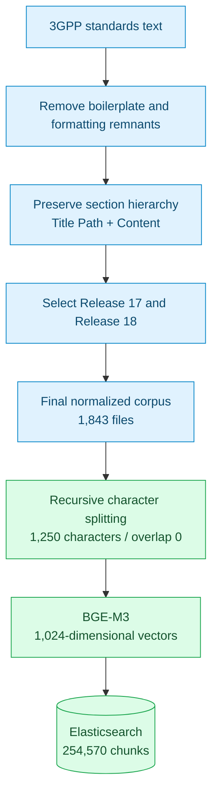

# Architecture

[README](../README.md)

## Corpus preparation



## Retrieval and generation

1. Retrieve the top 1,000 BM25 and dense-search passages using the question.
2. Combine ranks with Reciprocal Rank Fusion, using `k = 10`.
3. Rerank fused candidates using BGE-M3 ColBERT-style late interaction.
4. Supply the top five passages to Llama-3-Instruct or Tele-it.
5. Evaluate MCQs by option matching and open-ended answers with the local Mixtral judge.

```text
RRF score = 1 / (10 + BM25 rank) + 1 / (10 + dense rank)
```

## Chat3GPP-2.0: proposed local architecture

```mermaid
flowchart LR
    Q["User question"] --> GRAPH["Neo4j graph retrieval<br/>documents, entities, meetings,<br/>working groups, contributors"]
    GRAPH --> DOCS["About 15 relevant TDocs"]
    DOCS --> CACHE{"Document cached?"}
    CACHE -->|"No"| DOWNLOAD["Download and extract"]
    CACHE -->|"Yes"| SPACE["Document workspace"]
    DOWNLOAD --> SPACE
    SPACE --> STREAM["Pathway ingestion<br/>parse / OCR / chunk"]
    STREAM --> HYBRID["Proposed local search<br/>BGE-M3 + Elasticsearch<br/>BM25 and HNSW"]
    HYBRID --> RANK["RRF + token-level reranking"]
    RANK --> GEN["Top 5 passages<br/>Llama-3 or Tele-it"]
    GEN --> ANSWER["Grounded answer"]
    classDef future fill:#fef3c7,stroke:#d97706,color:#78350f
    class GRAPH,DOCS,CACHE,DOWNLOAD,SPACE,STREAM,HYBRID,RANK,GEN,ANSWER future
```



The report describes Neo4j document selection and Pathway ingestion. The proposed local stack uses BGE-M3, Elasticsearch, Llama-3-Instruct, and Tele-it.
