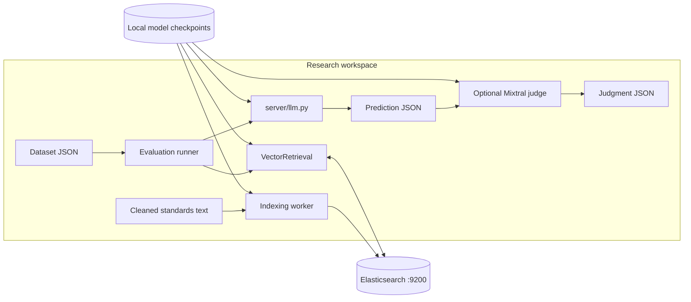
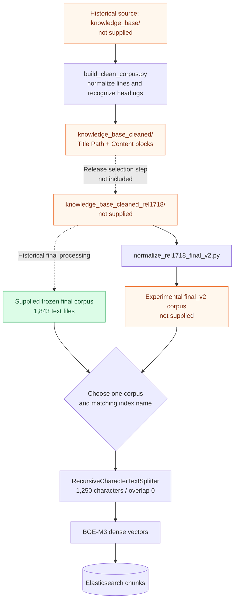
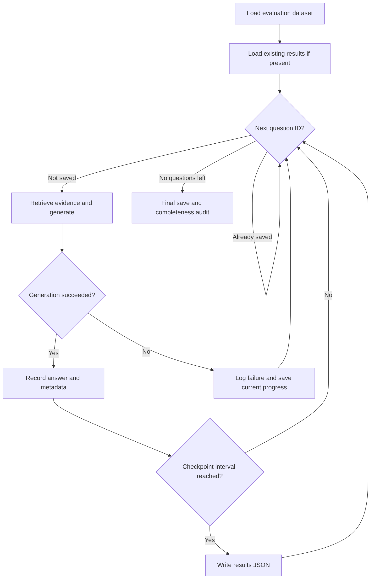

```mermaid
flowchart LR
    Q["User question"] --> GRAPH["Neo4j graph retrieval<br/>documents, entities, meetings,<br/>working groups, contributors"]
    GRAPH --> DOCS["About 15 relevant TDocs"]
    DOCS --> CACHE{"Document cached?"}
    CACHE -->|"No"| DOWNLOAD["Download and extract"]
    CACHE -->|"Yes"| SPACE["Document workspace"]
    DOWNLOAD --> SPACE
    SPACE --> STREAM["Pathway ingestion<br/>parse / OCR / chunk"]
    STREAM --> HYBRID["Proposed local search<br/>BGE-M3 + Elasticsearch<br/>BM25 and HNSW"]
    HYBRID --> RANK["RRF + token-level reranking"]
    RANK --> GEN["Top 5 passages<br/>Llama-3 or Tele-it"]
    GEN --> ANSWER["Grounded answer"]
    classDef future fill:#fef3c7,stroke:#d97706,color:#78350f
    class GRAPH,DOCS,CACHE,DOWNLOAD,SPACE,STREAM,HYBRID,RANK,GEN,ANSWER future
```

# Architecture and data flow

[Back to README](../README.md)

## System boundary

This is a Python batch pipeline. The `server/` directory contains model helpers; it does not define a web server. Elasticsearch is the external search service. Model checkpoints live outside the repository, and each evaluation script writes JSON results locally.



## Ingestion and corpus lineage

The supplied corpus is `knowledge_base_cleaned_rel1718_final/`. Earlier source directories and release-selection scripts described in the report are absent. `release_map.json` supplies metadata, but the included indexing worker does not use it to filter documents.



`build_clean_corpus.py` detects numbered headings, carries a hierarchy of titles, excludes selected boilerplate headings and annex content, and emits `Title Path:` / `Content:` blocks. It falls back to flattened text if it cannot produce sections. This script shows an earlier cleaning stage; the snapshot does not prove the complete transformation history of every supplied file.

The indexing worker stores `content`, `embedding`, `filename`, and an ingestion `date`. The date is a UTC ingestion timestamp, not the specification release date. The mapping has no dedicated release or clause field.

## Hybrid search in detail

[`retrievers/VectorRetriever.py`](../retrievers/VectorRetriever.py) implements the active retrieval path:

1. BM25 returns the top 1,000 lexical hits.
2. BGE-M3 encodes the question into a dense vector. Elasticsearch scores every matching document with `cosineSimilarity(...) + 1.0` under `match_all` and returns 1,000 hits.
3. Reciprocal Rank Fusion combines document ranks, using one-based ranks and `k = 10`.
4. The first `int(top_k1 / 10)` fused IDs are fetched individually: 100 candidates at the default setting.
5. BGE-M3 ColBERT representations rerank those candidates.
6. The top five passages become the generator context.

For a document found by both searches:

```text
RRF(document) = 1 / (10 + BM25 rank) + 1 / (10 + dense rank)
```

A document appearing in only one list receives only that list's contribution. The code fuses ranks rather than raw scores.

```mermaid
sequenceDiagram
    participant Runner as Evaluation runner
    participant Retriever as VectorRetrieval
    participant BGE as BGE-M3
    participant ES as Elasticsearch
    participant LLM as Local Llama / Tele-it
    Runner->>Retriever: Question text only
    Retriever->>ES: BM25 match, top 1000
    ES-->>Retriever: Ranked IDs
    Retriever->>BGE: Dense encode(question)
    BGE-->>Retriever: 1024-dimensional vector
    Retriever->>ES: Scripted cosine, top 1000
    ES-->>Retriever: Ranked IDs
    Note over Retriever: RRF k=10; retain top 100
    loop Each fused candidate
        Retriever->>ES: Fetch content by ID
        ES-->>Retriever: Passage text
    end
    Retriever->>BGE: ColBERT query and passage representations
    BGE-->>Retriever: Late-interaction scores
    Retriever-->>Runner: Top 5 passages
    Runner->>LLM: Context + question + options for MCQ
    LLM-->>Runner: Generated answer
    Note over Runner: Save predictions; score or judge separately
```

### Reranking behavior matters

The active retriever cleans and truncates question and passage text to 1,000 characters for ColBERT encoding. It assigns a very low score to passages whose reranking fails. This representation differs from the original stored chunk and may omit useful evidence near the end.

`server/reranker.py` contains a separate cached BGE-M3 helper, but `search_rrf()` calls its own `rerank_colbert()` implementation. Changing the standalone helper does not change the active retrieval path.

## Generation and checkpoints

`server/llm.py` loads a local checkpoint through Transformers in FP16, places it on the requested device, seeds NumPy and Torch with 42, and generates greedily with `do_sample=False`, a repetition penalty of 1.05, and a default maximum of 256 new tokens. Prompts are tokenized directly; this helper does not apply a chat template.

The four principal v2 RAG runners restore an existing result dictionary and skip IDs already present. They checkpoint every 10 completed results and write once more at the end. Use a distinct output path for each new corpus, prompt, or model experiment so results do not mix.



Generation checkpoint writes are not atomic. The v3 Mixtral judge uses a temporary file followed by `os.replace`. Resume behavior differs in older variants; inspect them before use.

## Report-described extension: Chat3GPP-2.0

The report, sections 44–59, describes a separate graph-guided application and a proposed local model stack. **These services are not implemented by this checkout.**



The report's existing 2.0 stack uses Voyage embeddings/reranking, USearch, Tantivy, and API-based generation. Replacing those components with local BGE-M3, Elasticsearch, and Llama models is a proposed direction. Its HNSW search should not be confused with this baseline's scripted-cosine implementation.
