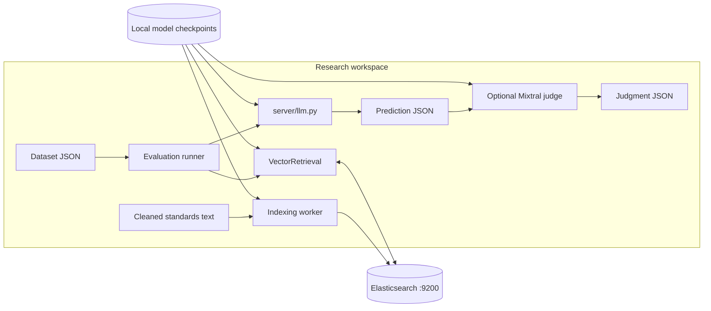
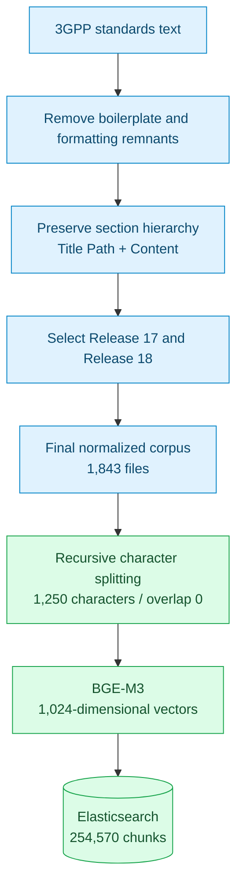
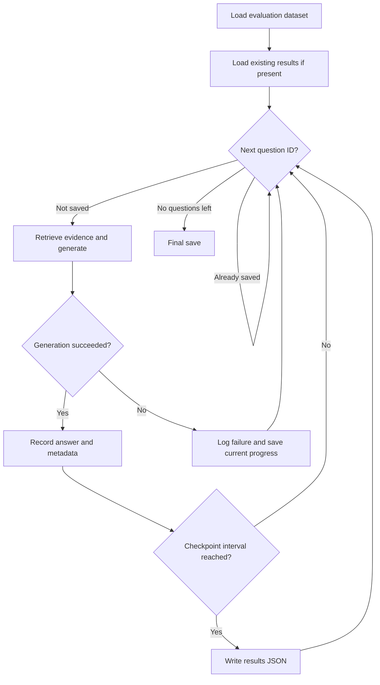

```mermaid
flowchart LR
    Q["User question"] --> GRAPH["Neo4j graph retrieval<br/>documents, entities, meetings,<br/>working groups, contributors"]
    GRAPH --> DOCS["About 15 relevant TDocs"]
    DOCS --> CACHE{"Document cached?"}
    CACHE -->|"No"| DOWNLOAD["Download and extract"]
    CACHE -->|"Yes"| SPACE["Document workspace"]
    DOWNLOAD --> SPACE
    SPACE --> STREAM["Pathway ingestion<br/>parse / OCR / chunk"]
    STREAM --> HYBRID["Proposed local search<br/>BGE-M3 + Elasticsearch<br/>BM25 and HNSW"]
    HYBRID --> RANK["RRF + token-level reranking"]
    RANK --> GEN["Top 5 passages<br/>Llama-3 or Tele-it"]
    GEN --> ANSWER["Grounded answer"]
    classDef future fill:#fef3c7,stroke:#d97706,color:#78350f
    class GRAPH,DOCS,CACHE,DOWNLOAD,SPACE,STREAM,HYBRID,RANK,GEN,ANSWER future
```

# Architecture and data flow

[Back to README](../README.md)

## System overview

Chat3GPP combines standards preprocessing, Elasticsearch indexing, BGE-M3 retrieval and reranking, local answer generation, and benchmark evaluation.



## Ingestion and corpus lineage

The report describes hierarchical cleaning, Release 17/18 filtering, normalization, chunking, and embedding. The selected final corpus contains 1,843 source files, with 254,570 chunks in `index_clean_rel1718_final`.



## Hybrid search in detail

[`retrievers/VectorRetriever.py`](../retrievers/VectorRetriever.py) implements the active retrieval path:

1. BM25 returns the top 1,000 lexical hits.
2. BGE-M3 encodes the question into a dense vector. Elasticsearch scores every matching document with `cosineSimilarity(...) + 1.0` under `match_all` and returns 1,000 hits.
3. Reciprocal Rank Fusion combines document ranks, using one-based ranks and `k = 10`.
4. The first `int(top_k1 / 10)` fused IDs are fetched individually: 100 candidates at the default setting.
5. BGE-M3 ColBERT representations rerank those candidates.
6. The top five passages become the generator context.

For a document found by both searches:

```text
RRF(document) = 1 / (10 + BM25 rank) + 1 / (10 + dense rank)
```

A document appearing in only one list receives only that list's contribution. The code fuses ranks rather than raw scores.

```mermaid
sequenceDiagram
    participant Runner as Evaluation runner
    participant Retriever as VectorRetrieval
    participant BGE as BGE-M3
    participant ES as Elasticsearch
    participant LLM as Local Llama / Tele-it
    Runner->>Retriever: Question text only
    Retriever->>ES: BM25 match, top 1000
    ES-->>Retriever: Ranked IDs
    Retriever->>BGE: Dense encode(question)
    BGE-->>Retriever: 1024-dimensional vector
    Retriever->>ES: Scripted cosine, top 1000
    ES-->>Retriever: Ranked IDs
    Note over Retriever: RRF k=10; retain top 100
    loop Each fused candidate
        Retriever->>ES: Fetch content by ID
        ES-->>Retriever: Passage text
    end
    Retriever->>BGE: ColBERT query and passage representations
    BGE-->>Retriever: Late-interaction scores
    Retriever-->>Runner: Top 5 passages
    Runner->>LLM: Context + question + options for MCQ
    LLM-->>Runner: Generated answer
    Note over Runner: Save predictions; score or judge separately
```

## Generation and checkpoints

Llama-3-8B-Instruct and Llama-3-8B-Tele-it generate answers from the retrieved passages. MCQ prompts include the answer options after question-only retrieval. Open-ended prompts request a direct answer based on context.

Generation scripts save progress and skip completed question IDs when resumed.



## Chat3GPP-2.0

The report describes graph-guided document selection with Neo4j, streaming ingestion through Pathway, and a proposed local retrieval and generation stack.



The report's existing 2.0 stack uses Voyage embeddings/reranking, USearch, Tantivy, and API-based generation. Replacing those components with local BGE-M3, Elasticsearch, and Llama models is a proposed direction.
