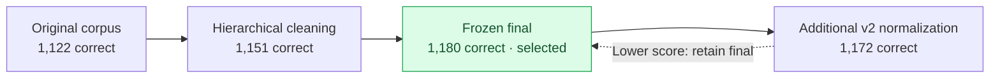

# Experiments, results, and evidence

[Back to README](../README.md)

## Evidence boundary

Historical results below are transcribed from the author's [internship report](Internship_Report_IITK.pdf), principally sections 18–24 and 38–43. This snapshot contains datasets, corpus files, runners, and status notes, but no completed prediction files, judge files, or Elasticsearch snapshot. Consequently these results cannot be independently recomputed from saved outputs here.

The internship period, January–May 2026, is supplied by the author. The exported folder and status filenames refer to a later archive; those timestamps do not establish the date each experiment ran.

## Corpus and retrieval evolution

Report section 18.1 lists these TeleQnA results over 1,514 questions:

| Configuration | Correct | Reported accuracy |
|---|---:|---:|
| Original corpus / RRF k10 | 1,122 | 74.108% |
| Original corpus / RRF k60 | 1,122 | 74.108% |
| Clean hierarchical index | 1,151 | 76.024% |
| **Frozen final** | **1,180** | **77.939%** |
| Final v2 | 1,172 | 77.411% |

The local status notes still describe v2 as an active or intended run. They are archival progress notes; the supplied report records a later comparison and selection. Neither note timestamps nor script suffixes should replace measured result provenance.

## Model and retrieval comparisons

| TeleQnA configuration | Correct / 1,514 | Reported accuracy |
|---|---:|---:|
| Llama-3-Instruct + final RAG | 1,180 | 77.939% |
| Tele-it + final RAG | 1,069 | 70.608% |
| Tele-it no RAG | 790 | 52.180% |
| Tele-it no RAG, paper-faithful prompt | 777 | 51.321% |

The report identifies the Tele-it + RAG branch as an internship extension to its reference baseline comparison. It also records a correction to an earlier Tele-it score caused by comparing numeric predictions with differently formatted gold strings.

| Tele-Eval configuration | Accepted / 58,627 | Reported acceptance |
|---|---:|---:|
| Llama-3-Instruct + RAG | 42,643 | 72.736% |
| Tele-it no RAG | 14,817 | 25.273% |
| Tele-it + RAG | 51,292 | 87.489% |

These percentages are reproduced as printed in the report. For example, 51,292 / 58,627 is approximately 87.4887%, which rounds to 87.489%. Small precision differences elsewhere should be resolved against original run outputs before claiming newly audited measurements.

The open-ended evaluator was local Q4 Mixtral with a 1,024-token context. It measures judge acceptance against references, not an independently established human correctness rate. Different prompts, quantization, or context windows can change decisions.

## Datasets actually present

| File | Entries | Role |
|---|---:|---|
| `data/teleqna/teleqna_paper.json` | 1,514 | Main MCQ input |
| `data/teleeval_58627_exact.json` | 58,627 | Main open-ended input |
| `data/teleeval_rel17.json` | 26,225 | Release 17 split |
| `data/teleeval_rel18.json` | 32,402 | Release 18 split |
| `data/teleeval_58627_candidate.json` | 58,627 | Historical candidate input |
| `data/teleeval_58629_almostpaper.json` | 58,629 | Historical near-match input |

Counts were checked by parsing the local JSON files. Identical counts alone do not prove two variants contain identical questions. The report gives a TeleQnA release split of 734 Release 17 and 780 Release 18 questions.

## What the findings support

Within the reported experiments, strong retrieval improves both models' access to standards facts. Tele-it's domain adaptation alone does not replace retrieval. The preferred generator changes with question format, which motivates evaluating MCQ and open-ended tasks separately.

These experiments do not isolate each component's causal effect. The report notes missing retrieval-recall measurements, incomplete BM25-only/dense-only ablations, no significance tests, and no calibration of the quantized judge against full-precision or human judgments.

## Comparison with the reference paper

The report quotes the original Chat3GPP paper at 78.7% TeleQnA accuracy and its own frozen local reproduction at 77.939%. These are separate experimental settings. The report attributes the difference mainly to processed text versus a raw Word-document preprocessing pipeline, but this attribution is an interpretation rather than a controlled causal measurement.

Other differences include exhaustive cosine search in local code, local ColBERT-style reranking, generation and parsing choices, and the quantized open-ended judge. The 2.0 graph design and proposed HNSW branch are not evidence that this checkout implements or evaluates graph retrieval.

For the reference-paper bibliographic entry and upstream credits, see the report bibliography. The documentation does not independently re-audit the original paper's numerical claims.
