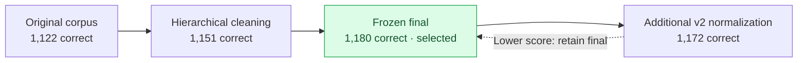

# Experiments and results

[Back to README](../README.md)

Results summarized from the [internship report](Internship_Report_IITK.pdf), sections 18–24 and 38–43.

## Corpus and retrieval evolution

Report section 18.1 lists these TeleQnA results over 1,514 questions:

| Configuration | Correct | Reported accuracy |
|---|---:|---:|
| Original corpus / RRF k10 | 1,122 | 74.108% |
| Original corpus / RRF k60 | 1,122 | 74.108% |
| Clean hierarchical index | 1,151 | 76.024% |
| **Frozen final** | **1,180** | **77.939%** |
| Final v2 | 1,172 | 77.411% |

## Model and retrieval comparisons

| TeleQnA configuration | Correct / 1,514 | Reported accuracy |
|---|---:|---:|
| Llama-3-Instruct + final RAG | 1,180 | 77.939% |
| Tele-it + final RAG | 1,069 | 70.608% |
| Tele-it no RAG | 790 | 52.180% |
| Tele-it no RAG, paper-faithful prompt | 777 | 51.321% |

The report identifies the Tele-it + RAG branch as an internship extension to its reference baseline comparison. It also records a correction to an earlier Tele-it score caused by comparing numeric predictions with differently formatted gold strings.

| Tele-Eval configuration | Accepted / 58,627 | Reported acceptance |
|---|---:|---:|
| Llama-3-Instruct + RAG | 42,643 | 72.736% |
| Tele-it no RAG | 14,817 | 25.273% |
| Tele-it + RAG | 51,292 | 87.489% |

Open-ended evaluation uses a local Q4 Mixtral judge with a 1,024-token context and Yes/No judgments.

## Evaluation datasets

| File | Entries | Role |
|---|---:|---|
| `data/teleqna/teleqna_paper.json` | 1,514 | Main MCQ input |
| `data/teleeval_58627_exact.json` | 58,627 | Main open-ended input |
| `data/teleeval_rel17.json` | 26,225 | Release 17 split |
| `data/teleeval_rel18.json` | 32,402 | Release 18 split |
| `data/teleeval_58627_candidate.json` | 58,627 | Historical candidate input |
| `data/teleeval_58629_almostpaper.json` | 58,629 | Historical near-match input |

The TeleQnA subset contains 734 Release 17 and 780 Release 18 questions.

## Main findings

Within the reported experiments, strong retrieval improves both models' access to standards facts. Tele-it's domain adaptation alone does not replace retrieval. The preferred generator changes with question format, which motivates evaluating MCQ and open-ended tasks separately.

## Comparison with the reference paper

| Configuration | TeleQnA accuracy |
|---|---:|
| Original paper Chat3GPP | 78.7% |
| Local reproduced Chat3GPP final | 77.939% |

The report explains the difference through the preprocessing sources: the original paper indexed raw 3GPP Word documents, while the local reproduction indexed processed and cleaned text. The internship also added the Tele-it + RAG branch, producing 70.608% on TeleQnA and 87.489% on open-ended Tele-Eval under the local Q4 Mixtral judge.
