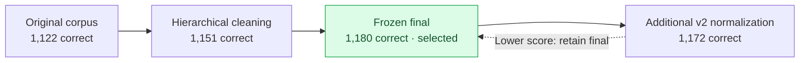

# Experiments and results

[Back to README](../README.md)

Results summarized from the [internship report](Internship_Report_IITK.pdf), sections 18–24 and 38–43.

## Corpus and retrieval evolution

Report section 18.1 lists these TeleQnA results over 1,514 questions:

| Configuration | Correct | Reported accuracy |
|---|---:|---:|
| Original corpus / RRF k10 | 1,122 | 74.108% |
| Original corpus / RRF k60 | 1,122 | 74.108% |
| Clean hierarchical index | 1,151 | 76.024% |
| **Frozen final** | **1,180** | **77.939%** |
| Final v2 | 1,172 | 77.411% |

## Comparison with the reference paper

| Configuration | TeleQnA accuracy |
|---|---:|
| Original paper Chat3GPP | 78.7% |
| Local reproduced Chat3GPP final | 77.939% |

The original paper used raw Word documents; the local reproduction used processed and cleaned text. Model comparison results are listed in the [README](../README.md).
